# Mobile Clock Dashboard

A local dashboard for the mobile team. It connects `tcp-software/mobile-clock` on GitHub with TCPMOB tickets in Jira, so PRs, builds, tickets, releases, and code health live in one place.

## At a Glance

One screen answers the questions a developer asks all day: What's stuck? What changed while I was away? What do I do next? It pulls GitHub, Jira, Tempo, Teams, and the team's calendar into one place, so nobody has to check six tools to know where their work stands.

> The screenshots and recordings below use sample data: the people, tickets, and pull requests are made up.

### Home: The Shift at a Glance

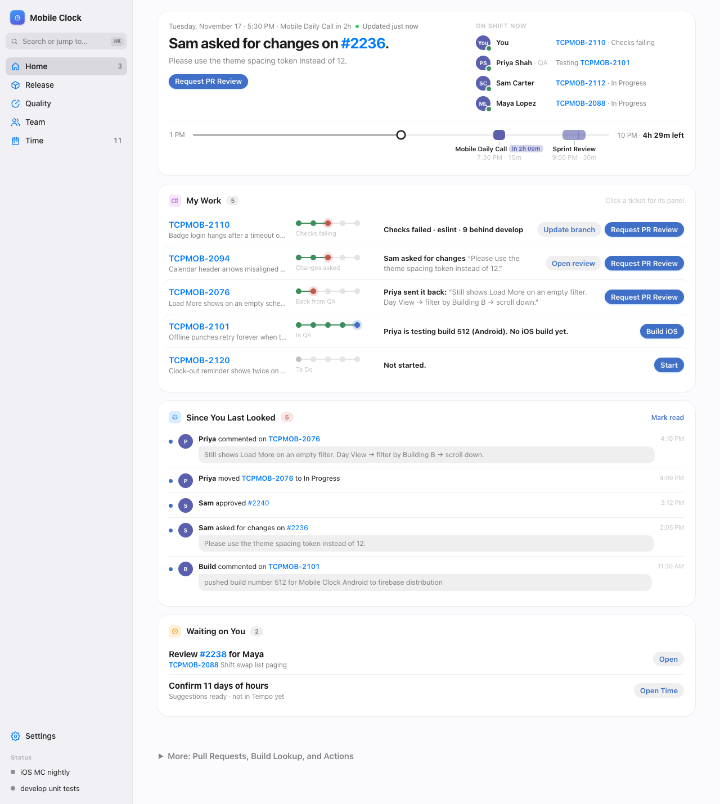

- **One headline** names the most important thing right now, with the button that handles it.
- **On Shift Now** shows what each teammate and QA is working on.
- **The shift line** runs from 1 PM to 10 PM with today's meetings from the calendar.
- **My Work** lists each ticket with its stage, what's blocking it, and one button to fix it.
- **Since You Last Looked** shows comments, reviews, and status changes made by other people.

Home changes with the shift: a standup draft and plan at the start, and a wrap-up checklist with to-dos for tomorrow at the end.

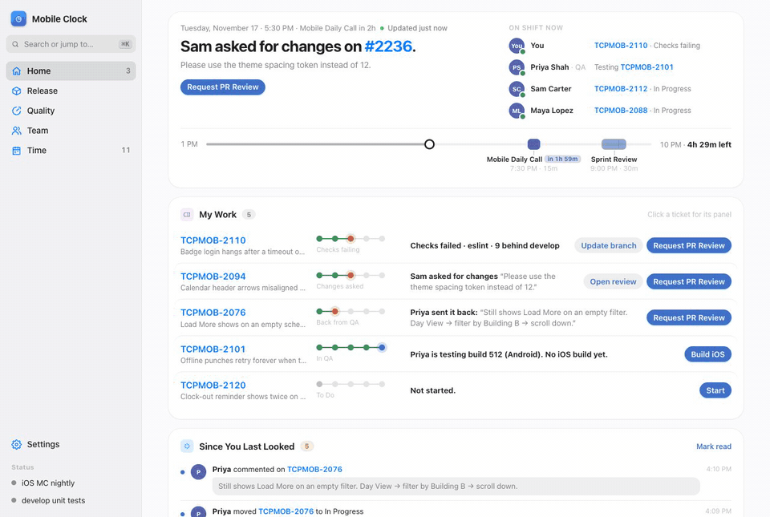

### Ticket Details Without Opening Jira

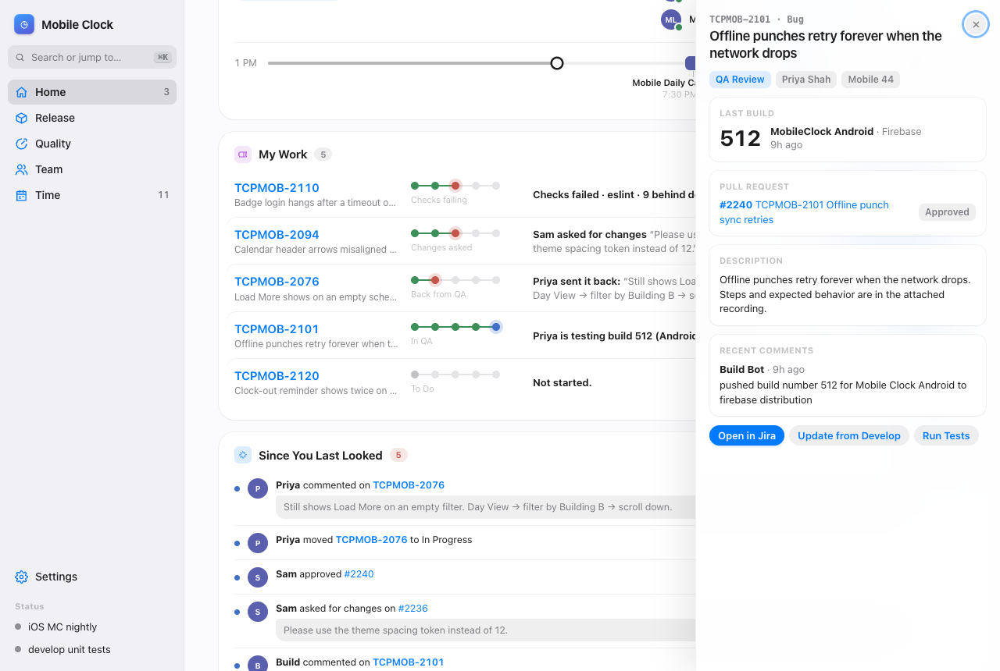

### Request a Review in One Flow

Request PR Review creates the pull request in the team's usual format if it doesn't exist yet, moves the ticket to Dev Review, and asks for a review on Teams. Nothing is posted until the developer confirms each step.

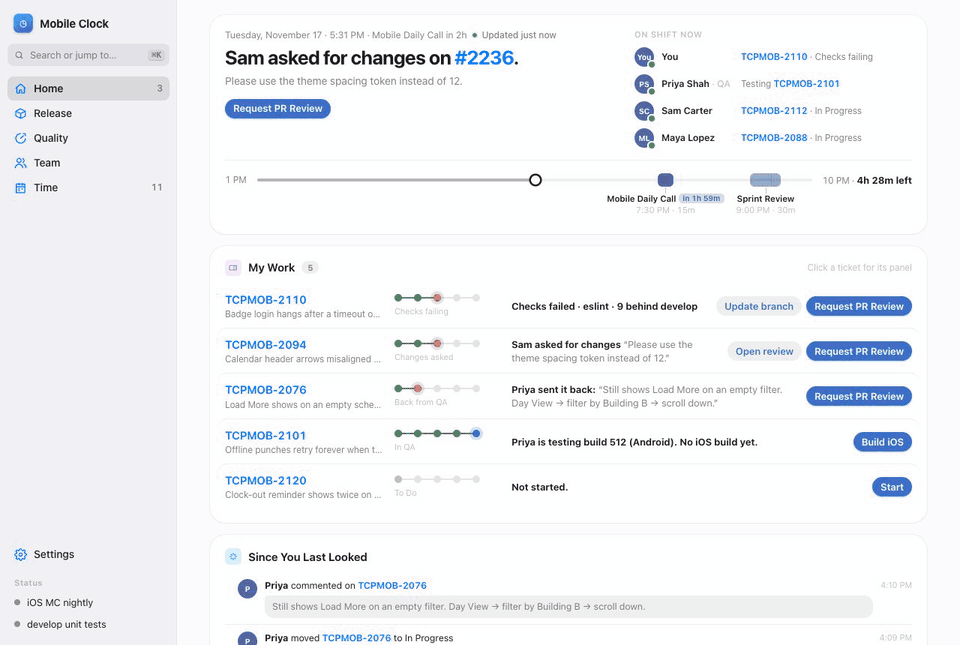

### Run Tests and Update a Branch

Run Tests runs the app's full test suite on the developer's Mac and shows the output live. Update from Develop brings the branch up to date and asks before pushing.

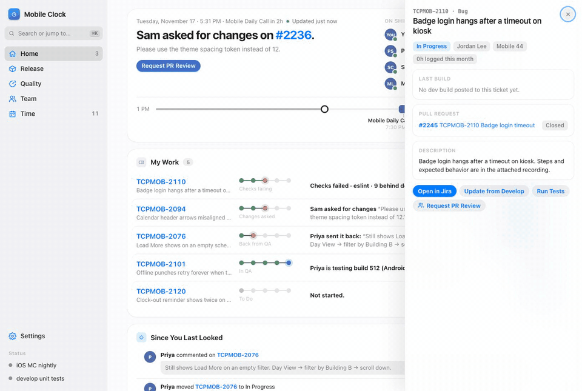

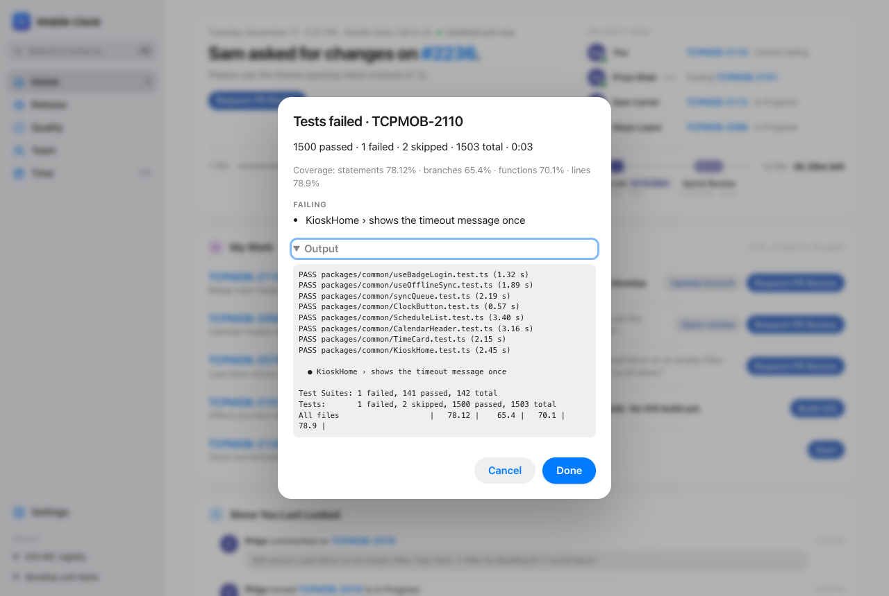

### Time Tracking With Evidence

The Time page suggests hours per ticket from real activity (Jira status changes, commits, builds, and coding sessions) and sends confirmed days to Tempo. Why Nh? shows exactly what the suggestion is based on.

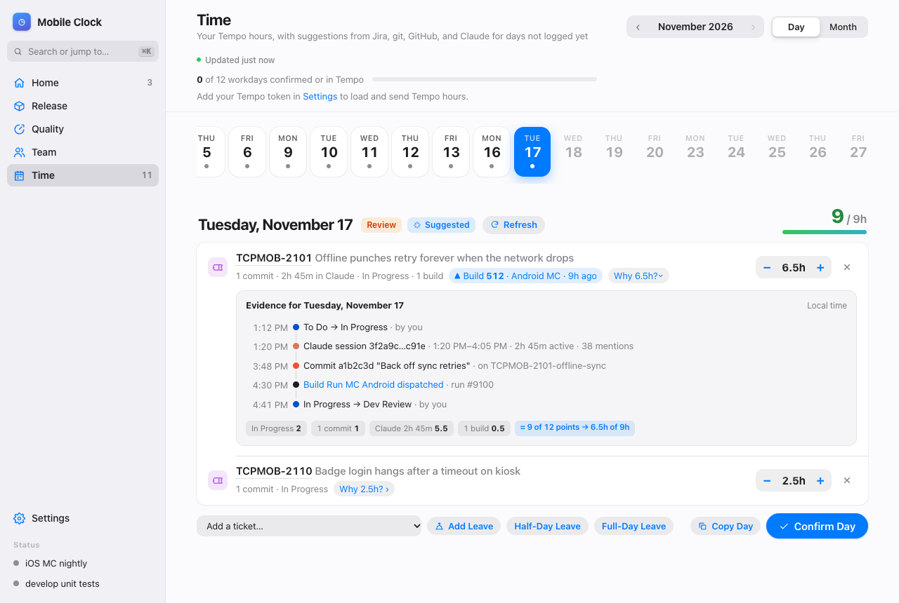

### Code Review and Team Health

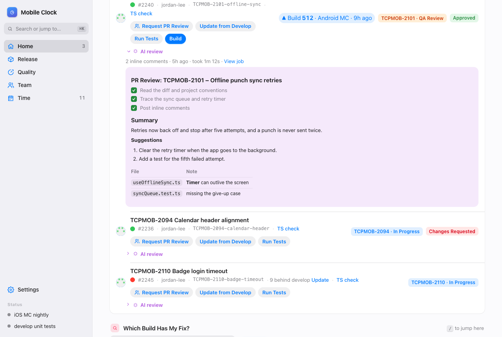

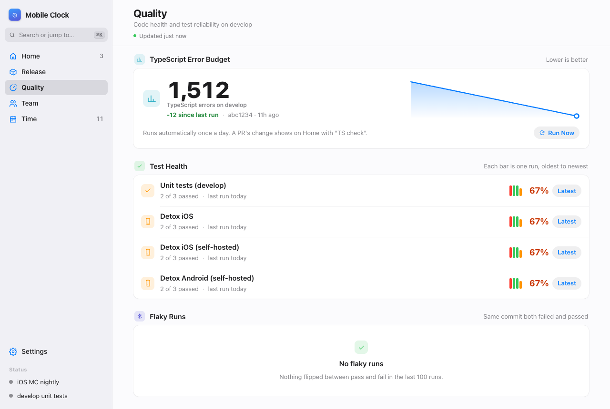

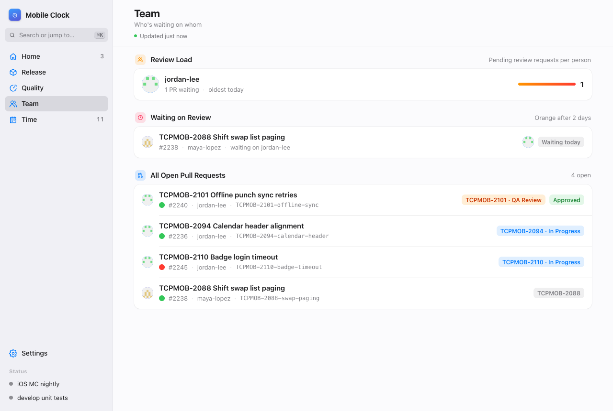

### Light or Dark, Set Up Per Person

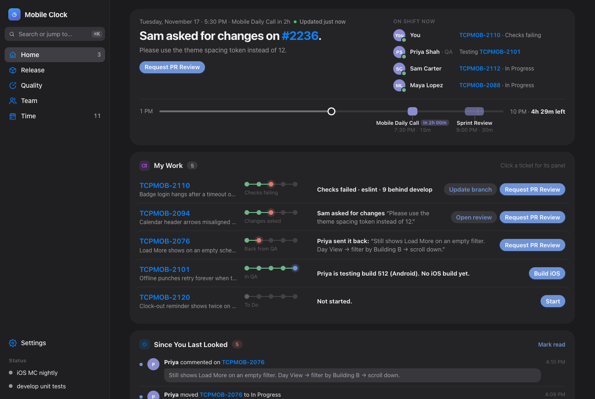

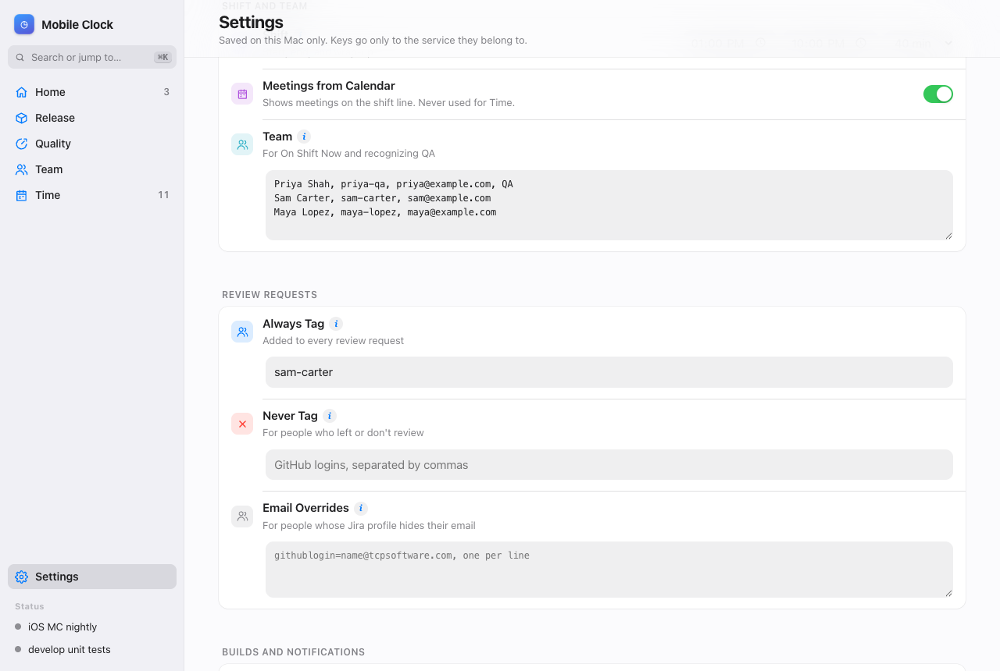

## Requirements

- Node 20 or later
- GitHub CLI (`gh`), logged in with access to `tcp-software` (`gh auth login`)
- Optional, for Jira features: a Jira API token
- Optional, for the TypeScript budget: a local clone of `mobile-clock` with `node_modules` installed
- Optional, for simulator installs: Xcode with a booted iOS simulator

## Setup

1. Clone this repo, then sign in to GitHub: `gh auth login`
2. Run `npm start`. The dashboard opens at http://localhost:4317.
3. Open **Settings** (the gear at the bottom of the sidebar, or press `,`) and add your own connections:
   - **Jira:** URL, email, and an API token from https://id.atlassian.com/manage-profile/security/api-tokens
   - **Tempo:** a token from Tempo's Settings, then API Integration
   - **Teams:** the review channel webhook and, if you like, a test chat webhook
4. Set your **workday hours** under Time Tracking. Time stays off until you do.

Settings are saved in `data/settings.json` on your Mac only. Git ignores the file, and only your Mac account can read it. After a key is saved, the page shows only its last 4 characters. **Test Connection** checks what you typed without saving or writing anything.

Without Jira, the GitHub features still work, and a banner links to Settings.

### Optional: `.env`

A `.env` file in this folder still works as a fallback. Anything set in Settings takes priority. Supported names: `JIRA_BASE_URL`, `JIRA_EMAIL`, `JIRA_TOKEN`, `TEMPO_TOKEN`, `TEAMS_WEBHOOK_URL`, `TEAMS_TEST_WEBHOOK_URL`, `TEAMS_ALWAYS`, `TEAMS_NEVER`, `TEAMS_PEOPLE`, `MOBILE_CLOCK_PATH`, and `TIME_REMINDER`.

## Settings

- **Connections:** GitHub (from `gh`), Jira, Tempo, and Teams, each with Test Connection
- **Appearance:** Light (default), Dark, or System
- **Time Tracking:**
  - **Workday hours:** 4–10h. Each saved day keeps the hours it was saved with, so changing this never rewrites past days.
  - **Evening reminder:** on or off, at a time you pick
  - **mobile-clock folder:** where your clone lives
- **Review Requests:** who's always tagged, who's never tagged, and email overrides for people whose Jira email is hidden
- **Builds and Notifications:** which builds are checked by default, and desktop notifications on or off

Changes apply right away, with no restart.

## Use It Like a Mac App

1. Run `npm run install-app` once. The dashboard starts now and every time you log in, and restarts by itself if it stops. Reminders and build retries keep running with no browser tab open.
2. Install the page as an app, so it gets its own window and a Dock icon:
   - **Chrome:** ⋮ menu → Cast, save, and share → Install page as app… (or the install icon in the address bar)
   - **Edge:** ⋯ menu → Apps → Install this site as an app
   - **Safari:** File → Add to Dock

- `npm run app-status` shows whether it is running. Logs are in `data/logs/server.log`.
- `npm run uninstall-app` removes the login item.
- After `git pull`, restart it with `npm run install-app` again.
- If Node moves (for example after a version upgrade), run `npm run install-app` again.
- Running `npm start` while it is already running just opens the running copy, so nothing runs twice.

## Usage

```bash
npm start   # starts the server and opens http://localhost:4317
npm test    # runs the test suite
```

**Ticket panel:** click any ticket key, ticket chip, or build chip to open a side panel with the ticket's status, last build, pull requests, description, latest comments, and hours this month. Esc closes it. The ⌘K palette has **Open ticket** too.

**Last build:** tickets with a "pushed build number" comment show a blue chip like "▲ Build 412 · Android MC · 2h ago" on Home and in Time.

**Freshness:** each section shows when its data was last updated. It turns orange with **Refresh** when it's older than it should be, and red with **Retry** when the last update failed. The data already on screen stays.

**Why these hours?** On Time, each ticket has a **Why Nh?** button. It opens that day's evidence: Jira status changes and who made them, Claude sessions (ID, times, active minutes, mentions), commits with their branch, and builds and reviews. Below it is the point math behind the hours. Claude chat text is never shown or stored.

**Pull to refresh** on any page: at the top, keep scrolling up with two fingers on the trackpad (or drag down on a phone) until the spinner turns blue, then let go. It reloads that page, skipping caches.

Press **⌘K** anywhere to search: jump to a view, open a pull request, check which build has a ticket (type its key), or switch theme. Number keys 1–5 switch views, `,` opens Settings, `/` jumps to the build lookup, and `t` opens Time.

Set `NO_OPEN=1` to start without opening a browser tab. Link straight to a view with `#home`, `#release`, `#quality`, or `#team`.

## Views

**Home** follows your shift (Settings → Shift and Team; default 1–10 PM, wrap-up in the last 40 minutes)
- **Top card:** one sentence about the most important thing right now, with its button; who's on shift and what they're working on; and a 1–10 PM shift line with today's meetings
- **My Work:** one row per ticket with its stage, what's blocking it (QA sent it back, checks failed, changes requested, merged with no build, QA testing one platform, behind develop, and more), and the one button that fixes it. Click a row for the ticket panel
- **Start of shift:** Since Last Shift, Today's Shift (focus time between meetings), Plan for This Shift, and your Note for Tomorrow
- **Mid-shift:** Since You Last Looked (other people's comments, reviews, and status changes), a Standup draft before a meeting named "standup," and Waiting on You
- **Wrap-up:** Before You Log Off (ticket branches with unpushed commits from the last 14 days, with **Copy push command**; QA requests; today's hours) and an editable Note for Tomorrow
- **Triggered Builds:** builds you started here, with live status, retry attempts, failure reason, and failure type
- **More:** Pull Requests (Mine and Review Requested), Which Build Has My Fix?, and Actions

**Team** (Settings → Shift and Team): one teammate per line, `Name, github-login, jira-email, QA`. Used for On Shift Now and to recognize QA on your tickets.

**Meetings** (Settings → Meetings from Calendar, off by default): read from the Calendar app on this Mac through a small Swift helper the dashboard compiles the first time (`tools/calendar.swift`, needs the Xcode command line tools). macOS asks for calendar access once. Titles stay in memory on this Mac: they're never saved, logged, or used for Time.

The dashboard never pushes or changes your mobile-clock clone. It only reads it.

**Release**
- The current "Mobile NN" fix version, days left, and whether its release branch is cut
- Tickets with open PRs, tickets with no PR found, unplanned merges, and cherry-pick candidates once the branch exists
- Release notes grouped into Fixes and Improvements, with a Copy button

**Quality**
- TypeScript error count on `develop`, with trend and a Run Now button
- Pass rates for unit tests and Detox, with how long ago each last ran
- Flaky runs: the same commit both failed and passed

**Team**
- Review load per person and PRs waiting on review
- All open pull requests

**Time** (press `t`)
- Suggested hours per ticket for each workday, always adding up to 7h, rebuilt from:
  - Jira: days your ticket was **In Progress** while assigned to you, plus your own status changes and comments
  - Git: your non-merge commits in the local `mobile-clock` clone (a ticket key in the commit message beats the branch name)
  - GitHub: builds you started (0.5 each, up to 1 per ticket per day; re-runs don't count again) and your reviews of other people's PRs (1 each, up to 2), matched to the ticket by branch name. GitHub keeps run history for about 90 days.
  - Claude Code sessions: the ticket each session mentions most, weighted toward what you typed and what Claude did, never injected memory or system text
- **Maybe:** under each day, up to 4 tickets with some activity but not enough to suggest. Examples: a teammate ticket you reviewed or built, a ticket past the 5-per-day limit, or one mentioned in Claude sessions without being the main topic. **+ Add** puts one on the day. On a day already in Tempo, it gets flagged so you add it in Tempo too. Epics are never offered.
- **Refresh** on a day reads every source again. Unconfirmed changes are replaced with fresh suggestions, after asking first. Confirmed days keep their hours.
- Each suggestion shows its evidence, for example `4 commits · 1h 40m in Claude · In Progress`
- Adjust with − and +; the other tickets rebalance to keep the day at 7h. Add leave as a half day, a full day, or any 0.5h step, and ticket hours fill the rest.
- **Confirm Day** saves the day locally. **Copy Day** gives text ready to paste into Tempo.
- **Month** mode shows every day and ticket at once, with **Copy Month** and **Export** (JSON or CSV, confirmed days only) for a future Tempo script
- A macOS reminder at 8:30 PM on workdays you haven't confirmed. Set `TIME_REMINDER=off` in `.env` to turn it off, or `TIME_REMINDER=19:00` to change the time.
- Claude chat text is never stored: the dashboard keeps only per-day ticket counts and times in `data/time/`, so history survives Claude's 30-day log cleanup.

## Tempo

Tempo is the source of truth. Each month loads your Tempo worklogs first, and only days with nothing in Tempo show suggestions.

- **In Tempo days:** show Tempo's hours, and any hours Tempo doesn't cover show as leave. You can edit them, but the dashboard never changes Tempo. If your edits differ, the day lists exactly what to change in Tempo by hand.
- **Send to Tempo:** on a confirmed day, or **Send Month** in Month mode. A preview shows every worklog first. Each worklog starts at 9:00 AM, and its description is the ticket's status at the end of that day. Leave isn't sent.
- **No double logs:** right before posting, each day is checked against Tempo again, and any day with a Tempo worklog is skipped. A day can't be sent twice at once.

Setup: in Tempo, open **Settings**, then **API Integration**, and create a token. Add `TEMPO_TOKEN="…"` to `.env`, then restart. Your Tempo account ID comes from Jira.

## Teams Review Requests

**Request Review** on your open, non-draft PRs posts your review message to a Teams channel. It shows a preview first and sends nothing until you press **Send to Teams**. The message uses the ticket key and Jira title, links to the ticket and PR, includes your optional note, and @mentions you and the requested reviewers.

Setup:
1. In the Teams channel, open **•••**, then **Workflows**, then **"Post to a channel when a webhook request is received"**, and copy the URL.
2. Add `TEAMS_WEBHOOK_URL="…"` to `.env`. Only Microsoft webhook addresses are accepted.
3. Optional: when a reviewer's Jira profile hides their email, they show as a plain name. To @mention them, add `TEAMS_PEOPLE="githublogin=email@tcpsoftware.com,other=…"`.

Messages appear from Workflows, not your own account. Each PR can be sent at most once every 30 minutes.

**GitHub speed:** common reads (PRs, runs, compares, branches, your login) go straight to GitHub's API using the token your signed-in `gh` already has. It's read once with `gh auth token`, kept in memory, and never saved or logged. Actions you click (create PR, builds, rerun, cancel, update branch) still run `gh`. Identical reads at the same moment share one call and are reused for 15 seconds; Refresh and any action clear that. If `HTTPS_PROXY` (or a similar proxy variable) is set, or GitHub can't be reached directly, the dashboard uses `gh` for everything.

## Actions That Change Things

Each one asks for confirmation first and is checked again on the server.

| Action | What it changes |
|---|---|
| Build | Starts dev builds (`release dev`, or `build dev .app` for the simulator option). QA and InfoSec are never notified, and prod builds can't be started. |
| Send to QA | Moves the ticket from Dev Review to QA Review. Only offered after a dev build was posted to the ticket. Posts no comment. |
| Start | Creates `TCPMOB-123-summary` from the latest `develop` on GitHub and assigns the ticket to you if it's unassigned. Doesn't change status. |
| Create Jira Bug | Creates a TCPMOB Bug from a failed build, linked to the PR's ticket |
| Update (behind base) | Merges the base branch into the PR branch |
| Rerun / Cancel | Reruns failed jobs or cancels a workflow run |
| Request Review | Posts a review request to your Teams channel |
| Request QA Review | On Dev Review tickets with a dev build: posts "ready for PRE-QA" to the QA channel and tags the QA group. Doesn't change the ticket. |
| Send to Tempo / Send Month | Creates Tempo worklogs for confirmed days that have nothing in Tempo. Never updates or deletes worklogs. |
| Install on Simulator | Downloads the `.app` artifact and installs it on a booted simulator |

## Automatic Behavior

- **Build retries:** builds triggered here are watched by the server, even with no tab open. Network, runner, disk, and timeout failures rerun their failed jobs up to 2 times. Code failures (TypeScript, tests, compile, lint) aren't retried and notify you right away. Cancelled builds are never retried.
- **TypeScript budget:** counts errors on `develop` once a day. It uses its own git worktree under `cache/` and links your clone's `node_modules`, so your working tree and branch are never touched.
- **Notifications:** a desktop alert when a triggered build succeeds or fails for good, or when a status badge turns red. Click the page once to allow them.

## Safety

- The server listens on `127.0.0.1` only and rejects requests from other sites.
- Build inputs and branches come from the server and GitHub, never from the browser.
- Ticket keys are validated before any Jira query.
- Triggered builds are saved in `data/builds.json`, so a restart keeps watching and retrying them. Finished builds drop off after 7 days.

## Later (Needs Credentials or Setup)

- Install links and QR codes for Firebase and TestFlight builds (Firebase service account, App Store Connect API key)
- App Store review status and Play rollout percentage (store API keys)
- Self-hosted runner health (repo admin access)
- Teams nudges and a morning standup digest (Teams webhook)
- Crashes by app version (Crashlytics export to BigQuery)

## Configuration

`config.js` holds the repo, port, workflows, status badges, Jira project, statuses, cache times, and retry limit.
